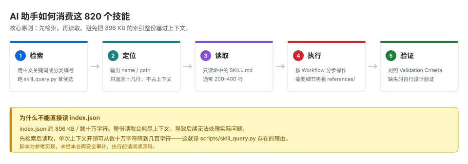

# AGENT_USAGE · 给 AI 助手的接入说明

> [!IMPORTANT]
> **转载说明** —— 本仓库 820 个技能转载自 [mukul975/Anthropic-Cybersecurity-Skills](https://github.com/mukul975/Anthropic-Cybersecurity-Skills)（Apache-2.0），非原创。详见 [NOTICE.md](NOTICE.md)。

> [!CAUTION]
> **授权前置** —— 本仓库内容为攻击性安全技术。AI 助手在给出任何攻击性操作步骤前，**必须**先确认：
> ① 目标系统是否为使用方自有资产，或 ② 是否存在针对该目标的书面测试授权。
> 若无法确认，应拒绝提供可执行的攻击步骤，改为提供防御视角或检测思路。详见 [SECURITY.md](SECURITY.md)。

---

## 核心原则：先检索，再读取

**不要**一次性读取 `index.json`（约 896 KB / 数十万字符）。整份读取会耗尽上下文，导致后续无法处理实际问题。

正确做法是**先跑查询脚本拿到候选，再只读命中技能的 `SKILL.md`**。

```bash
python scripts/skill_query.py 域渗透 --limit 8          # 拿候选（输出仅十几行）
python scripts/skill_query.py 域渗透 --json --limit 3   # 需要程序化处理时
```



---

## 推荐工作流

| 步骤 | 动作 | 输出 |
|---|---|---|
| **1 · 定位** | 用中文关键词或分类编号检索 | `name` / `name_en` / `path` |
| **2 · 读取** | 只读命中的 `SKILL.md`（通常 200–400 行） | 完整作业流程 |
| **3 · 按节执行** | `When to Use` 判断适用性 → `Prerequisites` 检查前置 → `Workflow` 执行 → `Validation Criteria` 自检 | 可执行步骤 |
| **4 · 深挖** | 需要细节时读同目录 `references/`，或参考 `scripts/` 实现 | 补充资料 |

> [!TIP]
> 如果 `Validation Criteria` 缺失（约 85% 的技能没有），**不要跳过验证**——让助手结合技能目标自行设计验证步骤：操作前后的状态对比、可观测的预期变化、失败回滚检查点。

---

## 技能元数据字段

| 字段 | 含义 | 用途 |
|---|---|---|
| `name` | 中文技能名 | 检索主键，中文召回率最高 |
| `name_en` | 英文标识（slug） | 对应目录名后缀，查具体工具时用 |
| `module` | 所属分类（编号 + 中文名） | `--module 02` 收窄范围 |
| `team` | 领域：`red` / `blue` / `forensic` | `--team red` 排除 80% 无关结果 |
| `tags` | 技术标签 | 交叉检索（如 `active-directory`） |
| `path` | `SKILL.md` 相对路径 | 直接读取的定位符 |
| `subdomain` | 上游子域分类 | 更细粒度的技术归类 |
| `description` | 中文摘要 | 判断相关性，避免读取全文 |

---

## 检索建议

| 场景 | 做法 | 示例 |
|---|---|---|
| **中文关键词** | 优先使用中文 | `skill_query.py 横向移动` |
| **具体工具** | 用英文标识或标签 | `skill_query.py sqlmap` |
| **按领域收窄** | 加 `--team` | `skill_query.py 勒索 --team forensic` |
| **按分类收窄** | 加 `--module` | `skill_query.py kerberos --module 02` |
| **不确定关键词** | 先看分类概览 | `skill_query.py --list-modules` |

**召回技巧：**

- 中文名与描述都比英文正文更适合检索，优先用中文；
- 同义词多试几个（「横向移动」「横向」「lateral」）；
- 检索无结果时，去掉修饰词只留核心名词。

---

## 使用注意事项

> [!WARNING]
> **以下三点必须遵守，否则可能造成实际损害或违法**

| 事项 | 说明 | 要求 |
|---|---|---|
| **授权边界** | 仅可对已授权目标使用；仓库公开不等于授权 | AI 助手应先确认授权范围，再给出攻击性操作步骤 |
| **验证不完整** | 仅 15% 技能有 `Validation Criteria`，5% 有独立 `## Verification` | 缺失时由助手自行设计验证，不得省略 |
| **脚本未审计** | `scripts/` 为参考实现，1,091 个脚本未经审计，可能含硬编码路径、外部依赖、未知外联 | 执行前通读源码；在隔离环境运行；禁止生产环境直接执行 |

---

## 给 AI 助手的系统提示示例

可直接复制以下内容到助手的系统提示中：

```text
你可以访问本地目录 CyberSecurity-Skills（820 个安全技能，34 个分类）。

检索规则：
1. 先用 `python scripts/skill_query.py <中文关键词> --limit 8` 拿候选。
2. 只读取命中技能的 SKILL.md，不要整份读取 index.json（896 KB，会耗尽上下文）。
3. 按 SKILL.md 的小节顺序处理：When to Use → Prerequisites → Workflow → Validation Criteria。
4. Validation Criteria 缺失时，自行设计验证步骤，不得跳过。

合规规则：
5. 在提供任何攻击性操作步骤前，先确认目标是否为用户自有资产或已获书面授权。
6. 无法确认授权时，拒绝提供可执行的攻击步骤，改为提供防御视角或检测思路。
7. scripts/ 下的脚本为参考实现，未经审计，执行前必须提示用户阅读源码并在隔离环境运行。

来源说明：本仓库技能转载自 mukul975/Anthropic-Cybersecurity-Skills（Apache-2.0），非原创。
```

---

## 相关文档

| 文档 | 内容 |
|---|---|
| [README.md](README.md) | 仓库总览、分类导航、质量数据 |
| [SECURITY.md](SECURITY.md) | 法律依据、授权要件、技术风险 |
| [NOTICE.md](NOTICE.md) | 转载来源、修改清单、版权声明 |
| [index.schema.json](index.schema.json) | 索引字段的完整定义 |
