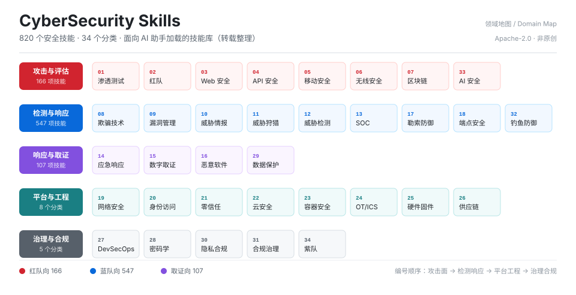

<div align="center">

# 网络安全技能库 · CyberSecurity Skills

**820 个面向 AI 助手的安全技能 · 34 个分类 · 转载整理**

[](#来源与版权)
[](index.json)
[](#分类导航)
[](#质量与局限)
[](LICENSE)

</div>

> [!WARNING]
> **转载声明 —— 本仓库不是原创项目，不主张任何原创著作权。**
>
> 仓库内全部 820 个技能（`SKILL.md`、`references/`、`scripts/`、`assets/`）**均转载自上游开源项目** [mukul975/Anthropic-Cybersecurity-Skills](https://github.com/mukul975/Anthropic-Cybersecurity-Skills)，版权归原作者所有。
>
> 本仓库的贡献仅限于：**目录重排、机器可读索引生成、检索脚本编写、导航文档整理**。除这一层整理工作外，无任何原创技能内容。
>
> 转载依据 Apache License 2.0；版权归属、修改清单与免责范围见 [来源与版权](#来源与版权) 与 [NOTICE.md](NOTICE.md)。

> [!CAUTION]
> **法律合规警示 —— 阅读或使用本仓库内容前，请确认你已理解以下边界。**
>
> 本仓库收录渗透测试、凭证窃取、横向移动、免杀规避、漏洞利用等**攻击性安全技术**。这些内容在**未经授权**的情况下使用，可能直接构成违法或犯罪行为。
>
> **在中国大陆境内**，主要涉及《中华人民共和国网络安全法》第二十七条、《中华人民共和国刑法》第二百八十五条、第二百八十六条、第二百八十七条之二等条款，详见 [安全边界与法律合规](#安全边界与法律合规)。
>
> 仅可在**你拥有所有权、或已取得书面授权**的系统上使用。**仓库公开可见不等于使用授权**；下载、留存、学习本身也不构成对目标系统的测试许可。

---

## 目录

| 章节 | 内容 |
|---|---|
| [项目背景](#项目背景) | 为什么会有这个仓库，解决什么问题 |
| [仓库构成](#仓库构成) | 四层结构：技能本体 / 索引 / 工具 / 文档 |
| [核心特性](#核心特性) | 8 项特性及其实际价值 |
| [使用场景](#使用场景) | 8 类具体场景与对应操作 |
| [快速开始](#快速开始) | 三条上手路径，各 1 分钟 |
| [分类导航](#分类导航) | 34 个分类的完整索引 |
| [索引与接口](#索引与接口) | `index.json` 字段说明与脚本用法 |
| [质量与局限](#质量与局限) | 实测覆盖率，含**不达标的项目** |
| [安全边界与法律合规](#安全边界与法律合规) | 法律依据、授权要求、技术风险 |
| [来源与版权](#来源与版权) | 转载依据、修改清单、权利主张 |
| [常见问题](#常见问题) | 6 个高频疑问 |
| [变更记录](#变更记录) | 版本历史 |

---

## 项目背景

### 上游项目解决了什么

[mukul975/Anthropic-Cybersecurity-Skills](https://github.com/mukul975/Anthropic-Cybersecurity-Skills) 把网络安全作业流程沉淀成了 820 个「技能包」——每个技能是一份结构化的操作手册，告诉执行者（人或 AI）在什么条件下、按什么步骤、用什么工具完成一项具体的安全任务。这是一项相当扎实的基础工作。

### 上游项目没有解决什么

直接使用上游仓库时，会遇到四个具体障碍：

| 障碍 | 具体表现 |
|---|---|
| **无法定位** | 820 个目录平铺在 34 个分类下，没有编号、没有排序，找一个技能靠逐级 `ls` |
| **无法检索** | 没有统一索引。想找「Kerberos 相关的所有技能」，只能对 820 个 `SKILL.md` 做全文 grep |
| **AI 不可用** | AI 助手没有「浏览目录」的能力。它必须先拿到一份结构化的清单，才知道有哪些技能可选 |
| **中文错配** | 技能正文几乎全为英文，中文使用者按「横向移动」检索时召回率极低 |

### 本仓库做的整理

针对上述四点，本仓库在上游内容之上加了一层工程化整理：

1. **目录重排** —— 由 `<分类中文名>_<英文名>/<技能目录>/` 改为 `<编号>-<分类中文名>-<英文名>/skills/<技能目录>/`，编号顺序按「攻击面 → 检测响应 → 平台工程 → 治理合规」的业务逻辑排列。
2. **索引生成** —— 从每个 `SKILL.md` 的 frontmatter 与正文中抽取字段，生成 `index.json`（820 条，每条含中文名、英文标识、领域、标签、路径）。
3. **检索工具** —— 提供零依赖脚本 `scripts/skill_query.py`，让 AI 助手能用一条命令把 820 个技能缩小到几个候选。
4. **文档体系** —— 根 README + 34 个分类页 + `AGENT_USAGE.md`，分别服务「人浏览」与「AI 接入」两种使用方式。

> [!IMPORTANT]
> 以上四项**均不涉及技能内容本身**。技能正文、脚本、参考资料一个字未改。这是本仓库与「原创项目」的根本区别。

---

## 仓库构成



### 四层结构

```
CyberSecurity-Skills/
│
├── 01-渗透测试-PenetrationTesting/          ← 第 1 层：分类目录（34 个）
│   ├── README.md                            该分类技能表（人读）
│   └── skills/
│       └── AD攻击模拟_executing-.../         ← 第 2 层：技能包（820 个）
│           ├── SKILL.md                     入口：何时用 / 前置 / 工作流 / 验证
│           ├── references/                  深入资料
│           ├── scripts/                     参考实现
│           ├── assets/                      图例与配置样例（部分技能有）
│           └── LICENSE                      Apache-2.0
│
├── index.json                               ← 第 3 层：机器索引（820 条）
├── index.schema.json                        索引的 JSON Schema
├── scripts/skill_query.py                   ← 第 4 层：检索工具
│
└── README.md · AGENT_USAGE.md · NOTICE.md · SECURITY.md · CHANGELOG.md
                                            文档层
```

### 单个技能包的内容构成

一个技能目录通常包含四类文件，角色各不相同：

| 文件 / 目录 | 角色 | 典型规模 |
|---|---|---|
| `SKILL.md` | **入口**。统一小节：`When to Use`、`Prerequisites`、`Workflow`、`Key Concepts`、`Tools & Systems`、`Validation Criteria`；frontmatter 含 `mitre_attack`、`nist_csf`、`tags` 等映射 | 200–400 行 |
| `references/` | 深入资料：协议细节、检测逻辑、配置样例 | 平均 2–3 篇 |
| `scripts/` | 参考实现，部分是可独立运行的工具 | 平均 1–2 个，共 1,091 个 |
| `LICENSE` | Apache-2.0 许可声明，转载时保留 | — |

---

## 核心特性

| # | 特性 | 说明 | 为什么重要 |
|---|---|---|---|
| 1 | **统一编号** | 34 个分类按 `01`–`34` 编号，业务顺序固定 | 沟通时可以只说「02 分类第 7 个技能」，不必描述路径 |
| 2 | **中文可检索** | 820 条索引均带中文名与中文描述 | 用「横向移动」「内存马」能直接命中；正文是英文，靠 grep 找不到 |
| 3 | **领域三分** | 每条标注 `red` / `blue` / `forensic`（166 / 547 / 107） | 红队任务加 `--team red` 即可排除 80% 无关结果 |
| 4 | **零依赖检索** | `skill_query.py` 只用标准库，Python 3.6+ 直接跑 | 不需要 `pip install`，不受内网环境限制 |
| 5 | **上下文友好** | 检索输出仅十几行，而非 896 KB 索引全文 | AI 助手能真正「用起来」，而不是读完索引就耗尽上下文 |
| 6 | **机器可读** | `index.json` + JSON Schema，可直接生成文档、菜单、其他格式 | 便于二次开发：做 CLI、做站点、做 IDE 插件 |
| 7 | **元数据映射** | `mitre_attack`、`nist_csf`、`tags` 字段完整保留 | 可以把技能对齐到 ATT&CK 战术或 CSF 控制项做覆盖度分析 |
| 8 | **诚实标注局限** | README 与 `AGENT_USAGE.md` 均列明未达标项 | 不把「820」包装成「820 个全部可验证」，避免使用者误判 |

---

## 使用场景

| 场景 | 做法 | 入口 |
|---|---|---|
| **AI 助手执行安全任务** | 让助手先跑检索脚本定位技能，再只读命中的 `SKILL.md` | [AGENT_USAGE.md](AGENT_USAGE.md) |
| **红队项目启动** | 按 `02 红队` + `--team red` 拉出攻击链相关技能，做行动规划参考 | `skill_query.py 域渗透 --team red` |
| **SOC 告警研判** | 查 `13 SOC` / `12 威胁检测`，找告警分级与调查剧本 | `skill_query.py 告警分级` |
| **应急响应处置** | 查 `14 应急响应` + `15 数字取证`，按工作流处置并保全证据 | `skill_query.py 勒索 --team forensic` |
| **检测规则开发** | 查 `11 威胁狩猎` / `12 威胁检测`，取检测逻辑与数据源要求 | `skill_query.py sigma` |
| **内部培训与考核** | 按分类挑选技能做课程大纲，`Prerequisites` 可作考核前置条件 | 从[分类导航](#分类导航)进入 |
| **工具二次开发** | 从 `scripts/` 取参考实现，重写为内部工具 | 直接读技能目录 |
| **合规自评** | 查 `31 合规与治理` / `30 隐私合规`，比对控制项 | `skill_query.py 等保` |

---

## 快速开始

### 路径一：只想看看（30 秒，无需任何环境）

从[分类导航](#分类导航)点进任意分类，分类页有该分类全部技能的表格：中文名、英文标识、摘要、直达链接。

### 路径二：想检索（1 分钟，只需 Python 3.6+）

```bash
git clone https://github.com/Jackon-Li/CyberSecurity-Skills.git
cd CyberSecurity-Skills

# 按中文关键词检索
python scripts/skill_query.py 横向移动

# 限定分类编号与领域
python scripts/skill_query.py kerberos --module 02 --team red

# 输出 JSON，供程序消费
python scripts/skill_query.py 云安全 --json --limit 5

# 查看全部分类概览
python scripts/skill_query.py --list-modules
```

### 路径三：接入 AI 助手（3 分钟）

把仓库放到 AI 助手可访问的位置，然后：

1. 告诉助手：**「先跑 `scripts/skill_query.py <关键词>` 拿候选，再只读命中的 `SKILL.md`」**
2. 或者直接把 [AGENT_USAGE.md](AGENT_USAGE.md) 作为系统提示的一部分提供给它


> [!TIP]
> 关键只有一句话：**先检索，再读取**。不要让助手整份读取 `index.json`。

---

## 分类导航

| # | 分类 | 技能数 | 领域 | 覆盖内容 |
|---|---|---|---|---|
| 01 | [渗透测试](01-渗透测试-PenetrationTesting/README.md) | 24 | 红队 | 授权范围内的漏洞发现与利用验证 |
| 02 | [红队](02-红队-RedTeaming/README.md) | 35 | 红队 | 模拟攻击者全流程行动与对抗 |
| 03 | [Web 应用安全](03-Web应用安全-WebApplicationSecurity/README.md) | 47 | 红队 | OWASP 类漏洞的发现、利用与修复 |
| 04 | [API 安全](04-API安全-APISecurity/README.md) | 28 | 红队 | REST / GraphQL / gRPC 接口攻击面 |
| 05 | [移动安全](05-移动安全-MobileSecurity/README.md) | 13 | 红队 | Android / iOS 应用逆向与攻击面 |
| 06 | [无线安全](06-无线安全-WirelessSecurity/README.md) | 2 | 红队 | Wi-Fi / BLE 等无线协议攻击 |
| 07 | [区块链安全](07-区块链安全-BlockchainSecurity/README.md) | 2 | 红队 | 智能合约审计与链上攻击 |
| 08 | [欺骗技术](08-欺骗技术-DeceptionTechnology/README.md) | 6 | 蓝队 | 蜜罐、蜜标与诱捕 |
| 09 | [漏洞管理](09-漏洞管理-VulnerabilityManagement/README.md) | 25 | 蓝队 | 资产测绘、优先级排序与修复闭环 |
| 10 | [威胁情报](10-威胁情报-ThreatIntelligence/README.md) | 52 | 蓝队 | 情报采集、研判与运营化 |
| 11 | [威胁狩猎](11-威胁狩猎-ThreatHunting/README.md) | 58 | 蓝队 | 假设驱动的主动搜寻 |
| 12 | [威胁检测](12-威胁检测-ThreatDetection/README.md) | 7 | 蓝队 | 检测规则与信号工程 |
| 13 | [安全运营中心](13-安全运营中心-SOCOperations/README.md) | 63 | 蓝队 | SOC 流程、告警分级与响应 |
| 14 | [应急响应](14-应急响应-IncidentResponse/README.md) | 26 | 取证 | 事件处置流程与遏制 |
| 15 | [数字取证](15-数字取证-DigitalForensics/README.md) | 41 | 取证 | 主机 / 网络 / 云取证与证据链 |
| 16 | [恶意软件分析](16-恶意软件分析-MalwareAnalysis/README.md) | 39 | 取证 | 样本静态与动态分析 |
| 17 | [勒索软件防御](17-勒索软件防御-RansomwareDefense/README.md) | 13 | 蓝队 | 预防、检测与恢复 |
| 18 | [端点安全](18-端点安全-EndpointSecurity/README.md) | 17 | 蓝队 | EDR、加固与主机防护 |
| 19 | [网络安全](19-网络安全-NetworkSecurity/README.md) | 43 | 蓝队 | 网络分段、流量分析与边界防护 |
| 20 | [身份与访问管理](20-身份与访问管理-IdentityAccessManagement/README.md) | 40 | 蓝队 | 认证、授权与特权管理 |
| 21 | [零信任架构](21-零信任架构-ZeroTrustArchitecture/README.md) | 18 | 蓝队 | 持续验证与最小权限落地 |
| 22 | [云安全](22-云安全-CloudSecurity/README.md) | 66 | 蓝队 | AWS / Azure / GCP 配置与攻击面 |
| 23 | [容器安全](23-容器安全-ContainerSecurity/README.md) | 33 | 蓝队 | K8s / 镜像 / 运行时安全 |
| 24 | [OT 与 ICS 安全](24-OT与ICS安全-OTICSSecurity/README.md) | 29 | 蓝队 | 工控协议与关键基础设施 |
| 25 | [硬件与固件安全](25-硬件与固件安全-HardwareFirmwareSecurity/README.md) | 6 | 蓝队 | 固件提取、侧信道与硬件攻击 |
| 26 | [供应链安全](26-供应链安全-SupplyChainSecurity/README.md) | 8 | 蓝队 | 依赖、构建与投毒防护 |
| 27 | [DevSecOps](27-DevSecOps-DevSecOps/README.md) | 18 | 蓝队 | 流水线内嵌安全门禁 |
| 28 | [密码学](28-密码学-Cryptography/README.md) | 16 | 蓝队 | 协议、密钥管理与后量子迁移 |
| 29 | [数据保护](29-数据保护-DataProtection/README.md) | 1 | 取证 | 数据分级、脱敏与防泄漏 |
| 30 | [隐私合规](30-隐私合规-PrivacyCompliance/README.md) | 2 | 蓝队 | GDPR / 个保法工程化落地 |
| 31 | [合规与治理](31-合规与治理-ComplianceGovernance/README.md) | 11 | 蓝队 | 等保、审计与风险治理 |
| 32 | [网络钓鱼防御](32-网络钓鱼防御-PhishingDefense/README.md) | 16 | 蓝队 | 邮件防护与安全意识 |
| 33 | [AI 安全](33-AI安全-AISecurity/README.md) | 14 | 红队 | 提示注入、模型与 Agent 攻击面 |
| 34 | [紫队](34-紫队-PurpleTeam/README.md) | 1 | 红队 | 红蓝协同与检测验证 |

> 合计 **820**：红队 166 · 蓝队 547 · 取证 107。领域划分沿用上游 `team` 字段，个别分类的归属见仁见智（如「32 网络钓鱼防御」也可视为安全意识工程）。

---

## 索引与接口


### 文件清单

| 文件 | 用途 | 使用方式 |
|---|---|---|
| [`index.json`](index.json) | 全量索引：34 模块 / 820 技能 | **不要整份读**，用脚本或按需取字段 |
| [`index.schema.json`](index.schema.json) | 索引的 JSON Schema | 校验数据、生成新格式、做编辑器提示 |
| [`scripts/skill_query.py`](scripts/skill_query.py) | 零依赖检索脚本 | `python scripts/skill_query.py <关键词>` |
| [`AGENT_USAGE.md`](AGENT_USAGE.md) | AI 助手接入规范 | 作为系统提示或直接交给助手读 |

### 索引结构

```jsonc
{
  "meta": {
    "version": "1.0.0",
    "total_skills": 820,
    "last_updated": "2026-10-18"
  },
  "modules": [
    {
      "dir": "02-红队-RedTeaming",
      "count": 35,
      "skills": [
        {
          "name": "ADCS ESC1漏洞利用",        // 中文名，检索主键
          "name_en": "exploiting-...-esc1",   // 英文标识，对应目录后缀
          "module": "02-红队",
          "team": "red",                      // red | blue | forensic
          "tags": ["active-directory", "adcs"],
          "path": "02-红队-RedTeaming/skills/.../SKILL.md",
          "subdomain": "active-directory",
          "description": "…"                  // 中文摘要
        }
      ]
    }
  ]
}
```

### 脚本参数

| 参数 | 作用 | 示例 |
|---|---|---|
| 位置参数 | 检索关键词（中文 / 英文 / 标签） | `skill_query.py 横向移动` |
| `--module` | 限定分类编号 | `--module 02` |
| `--team` | 限定领域 | `--team red` |
| `--limit` | 返回条数 | `--limit 5` |
| `--json` | JSON 输出（供程序消费） | `--json` |
| `--list-modules` | 列出 34 个分类概览 | `--list-modules` |

---

## 质量与局限

> [!NOTE]
> 以下为**实测数据**，不是宣称。统计口径：对 820 个 `SKILL.md` 做二级标题扫描。

| 小节 | 覆盖率 | 判断 |
|---|---|---|
| `Prerequisites` | 100% | 达标 |
| `When to Use` | 99.6% | 达标 |
| `Workflow` | 74% | **约四分之一缺失** |
| `Key Concepts` | 58% | 部分缺失 |
| `Tools & Systems` | 46% | 半数以上缺失 |
| `Validation Criteria` | 15% | **严重不足** |
| 独立 `## Verification` 小节 | 5% | **几乎不可依赖** |

**这意味着什么：**

- **不能假设每个技能都有逐条验证步骤。** 约 80% 的技能以「工作流 + 注意事项」为主，验证需结合 `Validation Criteria`（若存在）与目标环境实际判断。
- **不能把技能当作「已验证的成熟方案」。** 它是作业流程的参考骨架，落地前需结合具体环境裁剪。
- **1,091 个 Python 脚本未经本仓库审计。** 平均 8.6 KB，命名高度统一（803 个 `agent.py` + 281 个 `process.py`），但可能存在硬编码路径、外部依赖、占位符或未知外联行为。**执行前必须通读源码。**

---

## 安全边界与法律合规

> [!CAUTION]
> **本节不是免责套话，是使用前置条件。请完整阅读后再使用本仓库任何内容。**

### 一、适用法律依据（以中国大陆为例）

本仓库收录的技术可同时用于防护与攻击，其**合法性完全取决于是否获得授权**。相关法律主要包括：

| 法律 | 条款 | 与本仓库的关联 |
|---|---|---|
| 《中华人民共和国网络安全法》 | **第二十七条** | 明确禁止非法侵入他人网络、干扰网络正常功能、窃取网络数据；并禁止**提供**专门用于上述活动的**程序、工具**，禁止明知他人从事危害网络安全活动而提供技术支持 |
| 《中华人民共和国刑法》 | **第二百八十五条** | 非法侵入计算机信息系统罪；非法获取计算机信息系统数据、非法控制计算机信息系统罪；**提供侵入、非法控制计算机信息系统的程序、工具罪** |
| 《中华人民共和国刑法》 | **第二百八十六条** | 破坏计算机信息系统罪 |
| 《中华人民共和国刑法》 | **第二百八十七条之二** | 帮助信息网络犯罪活动罪 |
| 《中华人民共和国数据安全法》 | 全篇 | 数据处理活动的合规义务；取证场景常涉及数据复制与留存 |
| 《中华人民共和国个人信息保护法》 | 全篇 | 取证、日志分析中可能触及个人信息，须遵循最小必要原则 |

> [!IMPORTANT]
> **特别注意《网络安全法》第二十七条的「提供工具」条款**：该条不仅规制直接攻击行为，也规制**提供专门用于危害网络安全的程序、工具**的行为。这意味着本仓库作为攻击性工具的集合，其**传播与提供**环节本身即可能落入该条的规制范围。这不是危言耸听，而是条文文义。
>
> 因此：**本仓库内容不构成任何形式的使用许可、技术指导或合法性背书。** 是否可用、如何可用，须由使用者结合自身所在司法辖区自行判断并承担全部后果。

**其他司法辖区**（如你不在此列，请自行核查当地法律）：

- 美国：Computer Fraud and Abuse Act，*18 U.S.C. § 1030*
- 欧盟：Directive 2013/40/EU（ attacks against information systems ）、GDPR（涉及个人数据时）

### 二、什么才算有效授权

口头同意、上级默许、「这是我们自己的系统但我不是管理员」均**不构成**有效授权。有效的测试授权通常应包含：

| 要素 | 说明 | 缺失后果 |
|---|---|---|
| **书面形式** | 授权书 / 委托合同 / Rules of Engagement 文档 | 事后无法举证，法律风险由执行者承担 |
| **明确目标范围** | 域名、IP 段、应用系统、账号范围清单 | 越界即等同于未授权 |
| **时间窗口** | 起止时间，是否允许非工作时间操作 | 窗口外操作可能触发告警并被追责 |
| **允许的技术手段** | 是否允许社会工程、DoS 测试、物理入侵 | 超范围手段即使未造成损害也可能违约 |
| **明确禁止项** | 禁止触碰的数据类型、系统、区域 | 触碰即事故 |
| **数据处理约定** | 取证/测试数据的存储、脱敏、销毁方式 | 触及《个人信息保护法》《数据安全法》 |
| **紧急联系人与中止机制** | 出现意外时的联系路径 | 事故扩大 |

### 三、允许与禁止的边界

**允许（仍需满足上述授权条件）：**

- 你**拥有所有权**的系统上的测试
- 已取得**书面授权**的渗透测试与红队评估项目
- 有明确规则的 CTF 竞赛
- 漏洞赏金计划中**明确列入范围**的目标（注意范围外资产一律不可碰）
- 内部红蓝对抗演练、检测规则开发与验证
- 安全教学、学术研究（需在隔离环境）

**禁止：**

- 未授权访问、控制、干扰、破坏任何系统
- 窃取、篡改、删除、泄露他人数据
- 扫描或探测未经授权的公网资产（**即使只是「看看有没有漏洞」**）
- 将本仓库的免杀、凭证窃取、横向移动等技术用于真实非授权目标
- 以本仓库内容制作、传播攻击工具或教程
- 任何违反所在地法律法规的行为

### 四、技术风险

| 风险 | 具体说明 | 缓解措施 |
|---|---|---|
| **脚本未审计** | 1,091 个 Python 脚本来自公开仓库，未经独立审计，可能存在后门、硬编码凭据引用或外部回连 | 执行前通读源码；在隔离虚拟机 / 容器中运行；禁止在生产环境直接执行 |
| **依赖投毒** | 部分脚本可能要求安装第三方包，存在供应链风险 | 只用可信源；锁定版本；在无外网的隔离环境验证 |
| **破坏性操作** | 部分技能涉及删除痕迹、服务停止、凭据重置等动作 | 先在快照环境演练；准备好回滚方案 |
| **数据合规** | 取证与日志分析易触及个人信息、商业秘密 | 遵循最小必要；脱敏后再分析；按约定销毁 |

### 五、责任划分

- 使用者独立承担因使用本仓库内容而产生的**全部法律责任与后果**。
- 本仓库维护者与原上游作者**不对任何直接或间接损失承担责任**，包括但不限于数据丢失、业务中断、法律责任。
- 本仓库内容按 **「AS IS」** 提供，**不附带任何明示或默示担保**，包括适销性、特定用途适用性与非侵权担保。
- 若你是**内容权利人**且认为本仓库的转载侵犯了你的权益，请提交 Issue，核实后将立即下架相关内容。

---

## 来源与版权

> [!WARNING]
> **本仓库不主张任何原创著作权。** 全部技能内容为转载；本仓库的贡献仅为工程化整理。

### 转载来源

| 项目 | 内容 |
|---|---|
| 原始仓库 | [mukul975/Anthropic-Cybersecurity-Skills](https://github.com/mukul975/Anthropic-Cybersecurity-Skills) |
| 原作者 | mahipal |
| 许可协议 | **Apache License 2.0** |
| 转载技能数 | 820 个（其中 819 个来自上游，1 个为本地收录） |
| 版权归属 | 归原作者及贡献者所有 |

### 本仓库做了哪些改动

| 类型 | 具体内容 |
|---|---|
| **改动** | ① 目录重排：`<分类中文名>_<英文名>/<技能>/` → `<编号>-<分类中文名>-<英文名>/skills/<技能>/`；② 删除 820 个内容完全重复的 `下载链接.txt`，来源信息集中记录于本文件 |
| **新增** | `README.md`、`index.json`、`index.schema.json`、`AGENT_USAGE.md`、`NOTICE.md`、`SECURITY.md`、`CHANGELOG.md`、`scripts/skill_query.py`、34 个分类 `README.md`、`assets/` 下的示意图 |
| **未改动** | 全部 `SKILL.md`、`references/`、`scripts/`、`assets/` 内容**保持原样**；每个技能目录下的 `LICENSE` **全部保留**；frontmatter 中的 `author`、`license` 字段未改动 |

### Apache-2.0 合规说明

Apache License 2.0 允许在保留版权声明与许可声明的前提下再分发，并要求对修改内容作出说明：

- **保留声明** —— 每个技能目录下的 `LICENSE` 均予保留，未删除、未修改。
- **说明修改** —— 修改内容已列于上表与 [NOTICE.md](NOTICE.md)。
- **不主张背书** —— 本仓库的整理工作不代表原作者对本仓库的认可或背书；原作者与本仓库无隶属、合作或授权关系。
- **商标** —— 本仓库不主张任何上游项目名称、标识的商标权。

### 关于第 821 个技能

`01-渗透测试-PenetrationTesting/skills/Kali授权渗透测试_kali-pentest` **不属于上游项目**，由本地收录。该技能的原始出处未在其文件内明确标注，故**无法确证其来源与许可状态**。若权利人对收录有异议，提交 Issue 后立即移除。

### 权利主张渠道

如你是任何内容的权利人，认为本仓库存在不当转载、署名缺失或许可冲突：

1. 在 [Issues](https://github.com/Jackon-Li/CyberSecurity-Skills/issues) 提交说明，注明涉及的具体路径；
2. 核实后将在 **7 日内**下架相关内容或补充署名；
3. 无需先行发起正式法律程序。

---

## 常见问题

<details>
<summary><b>Q1：这些技能是原创的吗？可以直接商用吗？</b></summary>

**不是原创，全部转载。** 商用前须自行评估：Apache-2.0 允许商业使用，但要求保留版权与许可声明、说明修改内容。同时注意技能内容涉及攻击性技术，商业分发可能触及《网络安全法》第二十七条的「提供工具」条款，需法律意见支持。
</details>

<details>
<summary><b>Q2：820 个技能，为什么有些只有 1–2 个？</b></summary>

技能数量反映上游对该领域的覆盖深度，不是本仓库的取舍。例如「34 紫队」只有 1 个、「29 数据保护」只有 1 个，而上游在「22 云安全」有 66 个。这是原项目的分布特征。
</details>

<details>
<summary><b>Q3：能直接照 SKILL.md 操作生产环境吗？</b></summary>

**不建议。** 三个原因：① 74% 的技能有 `Workflow`，但只有 15% 有 `Validation Criteria`，验证环节多数需自行设计；② 技能是中立的操作流程，未考虑你的具体环境约束；③ `scripts/` 下的脚本未经审计。正确用法是**当作作业清单参考**，结合环境裁剪后再执行。
</details>

<details>
<summary><b>Q4：为什么不做成一个单文件的大 Markdown？</b></summary>

参考项目 [Hi-FullHouse/CyberSecurity-Skills](https://github.com/Hi-FullHouse/CyberSecurity-Skills) 是单文件知识库（约 938 KB），适合人阅读但不适合 AI 消费：AI 无法在 938 KB 中精准定位一小节，且单次读取成本极高。本仓库选择「保留 820 个独立技能包 + 统一索引 + 检索脚本」，是为了让 AI 能**按需加载**而非全量载入。
</details>

<details>
<summary><b>Q5：上游更新了怎么办？</b></summary>

本仓库是**时间点快照**（2026-10-18），不会自动同步上游。如需最新内容，直接从上游仓库获取；如需在本仓库基础上更新，按 [NOTICE.md](NOTICE.md) 记录改动即可。
</details>

<details>
<summary><b>Q6：发现有技能内容错误或脚本问题，该报给谁？</b></summary>

内容层面的问题（技术描述错误、步骤过时）**应报给上游项目原作者**——本仓库未修改内容，在此提 Issue 无法修正源头。本仓库只处理：索引错误、链接失效、检索脚本缺陷、目录结构问题。
</details>

---

## 变更记录

| 版本 | 日期 | 主要变化 |
|---|---|---|
| v1.1.0 | 2026-10-18 | 视觉体系重做（徽章、领域地图、流程图、GitHub Alerts）；补充项目背景与使用场景；强化法律合规章节；新增转载声明与版权说明；修复 92 条含空格断链 |
| v1.0.0 | 2026-10-18 | 首次发布：820 技能 / 34 分类 / 统一索引 / 检索脚本 |

详见 [CHANGELOG.md](CHANGELOG.md)。

---

<div align="center">
<sub>

本仓库为**转载整理**项目 · 技能内容版权归原作者 [mahipal](https://github.com/mukul975/Anthropic-Cybersecurity-Skills) 所有 · 按 Apache-2.0 分发
整理层（索引 / 脚本 / 文档）同样以 Apache-2.0 发布 · 见 [LICENSE](LICENSE)

</sub>
</div>
